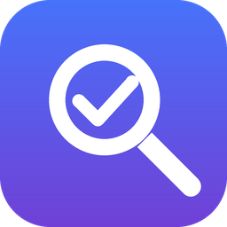
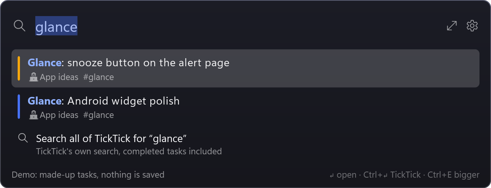
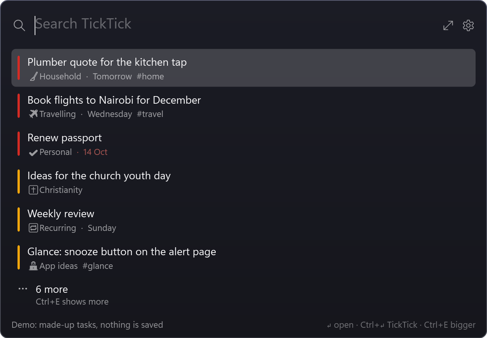
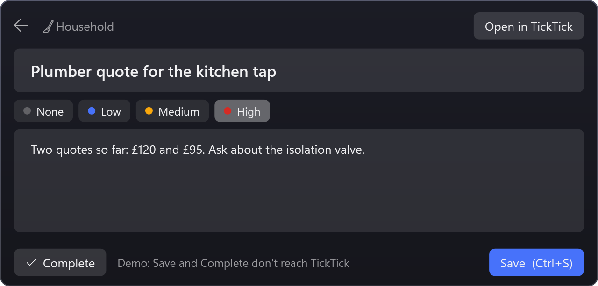
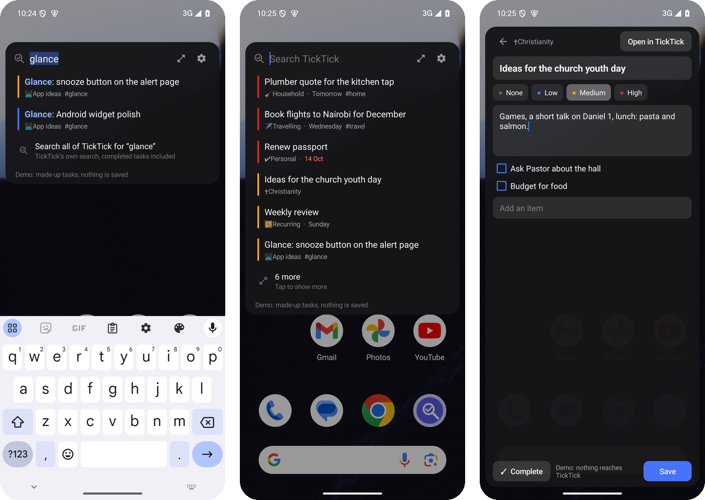

  

<h1 align="center">Tickfind</h1>

  Quick search for your TickTick tasks, on Windows and Android. 
  One shortcut, type a few letters, and the task is there. Sorted by priority, editable on the spot.

  
  
  
  
  

  

## Why

You have a thought, and it's about something already in TickTick. On a phone that means: home screen, TickTick, the bottom bar, the ⋯ menu, Search, and then TickTick's search, which can't sort by priority and often ranks the task you meant below unrelated ones.

Tickfind is a search box that's always one action away. It keeps an index of every open task and note on your device, so results appear as you type, and tapping one opens a small editor for the times you only need to add a line or read something.

## Features

- **One action away.** Windows: <kbd>Ctrl</kbd>+<kbd>Alt</kbd>+<kbd>F</kbd> from anywhere (next to TickTick's <kbd>Ctrl</kbd>+<kbd>Alt</kbd>+<kbd>T</kbd> quick add, if you use that). Android: a floating bubble, a Quick Settings tile, the assistant gesture, or the app icon. See [Opening it fast](#opening-it-fast-on-android).
- **Views when it opens.** Before you type, chips under the box show saved searches: *Today*, *Recently edited* and *Recently added* to start with. Add your own, rename them and put them in your order; the box opens on the first. See [Views](#views).
- **Results as you type**, from every list: titles, notes, checklist items, tags and list names. Every word you type has to match, and case and accents don't matter.
- **Sorted by priority by default**, then by how well it matches, then by what changed last. Switch to best match, due date, recently changed or recently added, as the default or for one search.
- **Filters in the box:** `#tag`, `~list`, `!high`, `due:today`, `is:note`, `-word`, `"exact words"` and more ([full list](#search)). Set a default filter that's added to every search, and leave whole lists out.
- **Forgiving.** If nothing matches exactly, it allows a typo per word, so `glnace` still finds *Glance*.
- **Quick edit.** Tap a match to read it, change the title, notes or priority, tick or add checklist items, or complete it. Before it saves, it checks whether the task changed in TickTick since you opened it, and asks rather than overwrite.
- **Open in TickTick** is one tap away from any match.
- **Compact or bigger.** A few matches by default; <kbd>Ctrl</kbd>+<kbd>E</kbd> (or ⤢) shows more.
- **Searches everything if you need it:** the last row hands your search to TickTick's own search, which includes completed tasks.
- **Updates itself** from GitHub releases on both platforms.
- **Nothing to set up.** Sign in to TickTick in your browser and that's it: no developer account, client ID or API key.

  
  

  

## Install

### Windows

1. Download **`Tickfind.exe`** from the [latest release](https://github.com/BosTheCoder/tickfind/releases/latest). It needs the [.NET 8 Desktop Runtime](https://dotnet.microsoft.com/download/dotnet/8.0); if you'd rather not install that, use `Tickfind-standalone.exe` (≈70 MB, no runtime needed).
2. Put it in a folder of its own, for example `C:\Apps\Tickfind\`, and run it.
3. Click **Sign in to TickTick**. Your browser opens TickTick's own consent page; click **Allow**. Tickfind reads your tasks once (a few seconds) and from then on searches instantly.

It starts with Windows from then on (switch that off under ⚙), and waits for <kbd>Ctrl</kbd>+<kbd>Alt</kbd>+<kbd>F</kbd>. Running `Tickfind.exe` again also opens the box.

Want to try it without TickTick first? Run `Tickfind.exe --demo`.

### Android

Download **`Tickfind.apk`** from the same release on your phone, install it, open **Tickfind settings** and tap **Sign in to TickTick**. Then pick how you'd like to open it. Details in **[docs/android.md](docs/android.md)**.

### Updating

Windows: ⚙ → **Check for updates** (it also tells you in the box when there's one). Android: Settings → **Check for updates**.

## Using it

| Do this | To |
| --- | --- |
| Type | Search. Matches update with each letter |
| Click / tap a chip, or <kbd>Tab</kbd> / <kbd>Shift</kbd>+<kbd>Tab</kbd> with the box empty | Switch view |
| <kbd>Ctrl</kbd>+<kbd>1</kbd> … <kbd>Ctrl</kbd>+<kbd>9</kbd> | Jump to that view |
| <kbd>↑</kbd> <kbd>↓</kbd>, then <kbd>Enter</kbd> (or click / tap) | Open a match in the quick editor |
| <kbd>Ctrl</kbd>+<kbd>Enter</kbd> on Windows, long-press on Android | Open the match in TickTick |
| <kbd>Ctrl</kbd>+<kbd>E</kbd> or ⤢ | Show more matches (and again for fewer) |
| <kbd>Ctrl</kbd>+<kbd>S</kbd> / **Save** in the editor | Save your changes to TickTick |
| <kbd>Ctrl</kbd>+<kbd>L</kbd> / **Copy link** in the editor | Copy the task's TickTick link |
| **Complete** in the editor | Mark it done (anything you typed is saved first) |
| <kbd>Esc</kbd> / Back | From the editor: back to the matches. From the matches: close |
| Click away / tap outside | Close. Unsaved edits stay put until you come back |
| <kbd>Ctrl</kbd>+<kbd>R</kbd> | Sync now (it also syncs by itself when it's been 5 minutes) |

### Search

| Type | Finds |
| --- | --- |
| `plumber quote` | Tasks where both words appear: title, notes, checklist, tags or list name |
| `"kitchen tap"` | Those words together |
| `-invoice` | Leaves out tasks with this word |
| `#home` | Tagged `home` (or a tag starting with it) |
| `~property` / `-~gcal` | In a list whose name contains this / not in one |
| `!high` `!med` `!low` `!none` | That priority (combine them: `!high !med`) |
| `due:today` `due:tomorrow` `due:week` `due:overdue` `has:due` `due:none` | By due date (several: any of them) |
| `due:today \| #today` | Either side of the `\|` (the default filter applies to both) |
| `is:note` `is:checklist` `is:task` | By kind |
| `sort:priority` `sort:best` `sort:due` `sort:modified` `sort:created` | Sort this search differently |

A search of only filters lists everything they let through, so `!high` on its own is "all my high-priority tasks", and `due:overdue` is what slipped.

### Views

While the box is empty, chips under it show your views: saved searches with a name. The box opens on the first one. Click or tap a chip to switch. Start typing and you're searching everything again; clear the box to get back to the view.

The starting three:

| View | Search |
| --- | --- |
| Today | `due:overdue due:today -~gcal \| #today`: due today or overdue (outside calendar-synced lists), or tagged `#today` |
| Recently edited | `sort:modified -~gcal` |
| Recently added | `sort:created` |

Change them on Windows under ⚙ → **Views…** (or `Views` in settings.json) and on Android in Settings → **Views**: rename, edit the search, ↑ ↓ to reorder, ✕ to remove, **Add view**. A view with an empty search lists everything in your default sort.

### Settings

On Windows, ⚙ has the common ones: sort order, how many matches, where **Open in TickTick** goes, the shortcut, lists to leave out, archived lists, start with Windows. Everything is also in `settings.json` next to the exe, picked up the next time the box opens:

| Setting | Default | |
| --- | --- | --- |
| `Hotkey` | `Ctrl+Alt+F` | Any `Ctrl`/`Alt`/`Shift`/`Win` + key. Empty for none |
| `Sort` | `Priority` | `Priority`, `Best`, `Due`, `Modified` or `Created` |
| `Results` / `ExpandedResults` | `6` / `25` | Matches shown, compact and bigger |
| `DefaultFilter` | `""` | Added to every search, e.g. `-~gcal` to skip calendar-synced lists |
| `ExcludeLists` | `[]` | List names to leave out entirely |
| `ArchivedLists` | `false` | Also index lists you've archived |
| `OpenIn` | `App` | `App`: TickTick for Windows. `Web`: the task in your browser |
| `RefreshMinutes` | `5` | Re-sync when the box opens if the index is older than this |
| `Width` | `640` | Width of the box |
| `Views` | Today, Recently edited, Recently added | `[{ "Name": "…", "Query": "…" }]`, in order. See [Views](#views) |

Android has the same settings on its settings screen.

### Opening it fast on Android

- **The assistant gesture.** In settings, tap **Use as the assistant app** and pick Tickfind as the *Default digital assistant app*. Then long-pressing the power button (or swiping up from a bottom corner, depending on the phone) opens the search box.
- **The floating bubble.** A small round button at the screen edge; tap it to search, drag it up or down or across to the other side. It's optional, and needs *Display over other apps*.
- **The Quick Settings tile.** Swipe down twice, tap the pencil, and drag **Search TickTick** in.
- **A side key or back tap.** Samsung's side-key double press and Pixel's Quick Tap can open any app; point them at Tickfind.
- **The app icon** opens straight to the search box (settings are behind ⚙).

### Open in TickTick

- **Android:** it sends TickTick the task's own link, which the TickTick app claims, so it opens in the app (or in the browser if TickTick isn't installed, or if you pick **The browser** in settings).
- **Windows:** TickTick for Windows has no way for another app to open one particular task, so Tickfind opens TickTick's own search on the task's title, which puts it at the top. If you'd rather land on the exact task, set **Open in** to the browser.

## Privacy

Tickfind talks to TickTick and to GitHub (for updates), nothing else. Sign-in uses TickTick's standard OAuth consent page with PKCE; Tickfind never sees your password. The access token and the task index stay on your device: on Windows next to the exe (the token encrypted with your Windows account), on Android in the app's private storage. **Sign out** deletes both.

## How it works

Both apps use TickTick's hosted MCP server (`mcp.ticktick.com`), the official endpoint TickTick provides for assistants, over plain JSON-RPC. Its OAuth server supports dynamic client registration, so each sign-in registers Tickfind as its own public client: no client secret is built in or needed. Tokens last about six months; after that Tickfind asks you to sign in again.

To index, it lists your projects and reads each open list's tasks, six at a time, then searches that copy on your device. Edits send only the fields you changed. More in [docs/development.md](docs/development.md).

## Later

Semantic search: embeddings over every task, so "that plumber thing" finds the kitchen tap quote even when no word matches. The search lives in one pure function on each platform (`Search.cs`, `Search.kt`), ready for it.

## Licence

MIT. Not affiliated with TickTick.
